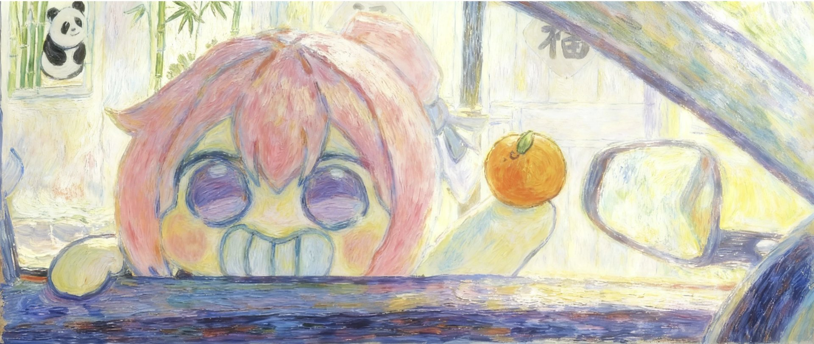

<!--
  个人主页 README · michaellu2007
  配套 .github/workflows/ 已就位，部署步骤见 SETUP.md
-->

  

# Hi there 👋

我是 **mini_doro**（[michaellu2007](https://github.com/michaellu2007)）

---

### 🚀 Projects

- **💘 [crush-monitor-agent](https://github.com/michaellu2007/crush-monitor-agent)** - 基于微信聊天记录的关系感知与陪伴决策 Agent 🚧 working on
  - 双系统架构：本地小模型（Ollama + JevK5）逐条做情绪 / 意图判断——免费；云端模型（GLM）负责顾问对话与回复生成，评估与生成分开路由
  - 微信式三栏界面：会话列表 / 聊天记录 / 顾问对话；chatlog 解密导入，多会话管理，好感度与关系阶段概览，可勾选记录当上下文问"下一步怎么聊"
  - 深度改造自 [FerryCorleone/crush-monitor](https://github.com/FerryCorleone/crush-monitor)（MIT），感谢原项目

- **📚 [fdu-note-summarized](https://github.com/michaellu2007/fdu-note-summarized)** - 复旦大学课程笔记：AI 辅助整理老师讲义与学长笔记 + 人工校对，离线 KaTeX 渲染，双击即开
  - 覆盖四门课：《数值算法与案例分析Ⅰ》（邵美悦老师荣誉课程）、《计算理论》、《数据结构》、《LLM与NLP》
  - 每篇笔记标注来源（板书 / 讲义 / 教材补充），公式全部走离线 KaTeX，不依赖网络

- **🏃 [campus-fit-tester](https://github.com/michaellu2007/campus-fit-tester)** - 自建校园体测系统的接口测试客户端（Node.js）
  - 走微信 PC 版小程序调试通道（WMPF + CDP），完整复现「登录 → 查询体测计划 → 开记录 → 心跳 → 提交」全流程
  - 用来检验自建服务端的防线：请求签名（sn / X-Sn-Verify / HMAC）、心跳节奏、距离合理性、围栏判定
  - 仅限自己部署或获得授权的系统使用（详见仓库内免责声明）

- **📈 [my-quant-lab](https://github.com/michaellu2007/my-quant-lab)** - 免费简陋的量化实验平台（Python）
  - qbot 回测 / 选股面板 + 均线交叉等策略脚本，数据源 AKShare / Tushare，零成本运行
  - 每日收盘自动跑批：策略信号生成 + 结果落盘，bat 一键启动

- **📱 [DanXi](https://github.com/michaellu2007/DanXi)** - DanXi（复旦校园一站式 App）个人自编译版，fork 自 [DanXi-Dev/DanXi](https://github.com/DanXi-Dev/DanXi)，仅 Android
  - 修复 TEE/Keystore 受损设备「每次重启都掉登录」：主密钥降级为普通 SharedPreferences 明文存储，绕开 Keystore 恢复流程；同时移除更新提示（签名与官方不同，无法覆盖升级）
  - ⬇️ 自编译 Release 下载：**[v1.5.3-selfbuild.1 APK](https://github.com/michaellu2007/DanXi/releases/download/v1.5.3-selfbuild.1/DanXi-1.5.3-selfbuild.1-android.apk)**（38.9 MB，sha256 `f926d471…90a94c`）· [Releases 页面](https://github.com/michaellu2007/DanXi/releases)
  - ⚠️ 仅适合刷机后安全芯片（TEE/Keystore）受损、重启反复掉登录的设备；从官方版切换需卸载重装（本地数据会清空），普通用户请使用官方版本

- **🛡️ [injection-defense-vs-utility](https://github.com/michaellu2007/injection-defense-vs-utility)** - Agent 能否拒绝提示注入的同时完成任务？安全–效用权衡实验 🚧 working on
  - 三臂对比（无防御 / spotlight 数据边界提示 / 工具输出过滤），每个注入案例配一个良性孪生，过度拒绝单独计分
  - 离线 mock 工具环境 + 合成金丝雀 secret、无网络动作；参考 AgentDyn / AgentDojo

- **⚖️ [small-classifier-vs-prompted-llm](https://github.com/michaellu2007/small-classifier-vs-prompted-llm)** - 小分类器什么时候胜过被 prompt 的 LLM？标签预算学习曲线实验 🚧 working on
  - 每类 k∈{8,32,128} 标注下三范式对比：TF-IDF+LogRes / MiniLM+LogRes / Qwen3-0.6B 8-shot
  - 首轮结论：k=8 起分类器全面反超 decoder，≥8 条标注/类时 encoder+线性头在 F1、校准、延迟上全面占优

- **📏 [dpo-shortcuts](https://github.com/michaellu2007/dpo-shortcuts)** - DPO 学的是正确性还是冗长度？长度捷径拆解实验 🚧 working on
  - 构造 SC / LC 两种偏好对（被偏好的都是正确但长度相反），把「正确性」与「长度/风格」两个维度拆开测
  - 试点发现 DPO-LC 学的是长度捷径（输出膨胀、42.5% 退化为复读、正确率反降），同数据 SFT 对照拿 0.90；复旦 NLP/LLM 课程 project

### 🏰 Interests

- **米奇妙妙屋 & 上海迪士尼**
- **📚 [Zotero](https://www.zotero.org/jingyao-lu2007)** - 文献管理与研究资料整理（michaellu2007@163.com）

### 🔧 Tech & Tools

      

### 📫 Connect

---

## 📊 GitHub Stats

## 📈 Contribution Graph

<picture>
  <source media="(prefers-color-scheme: dark)" srcset="https://raw.githubusercontent.com/michaellu2007/michaellu2007/output/github-contribution-grid-snake-dark.svg" />
  <source media="(prefers-color-scheme: light)" srcset="https://raw.githubusercontent.com/michaellu2007/michaellu2007/output/github-contribution-grid-snake.svg" />
  
</picture>
